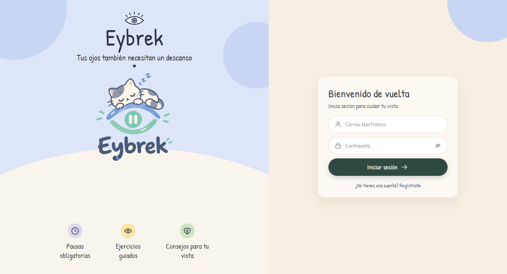
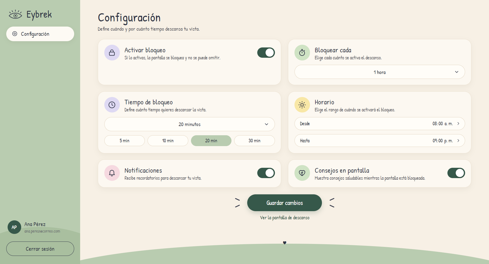
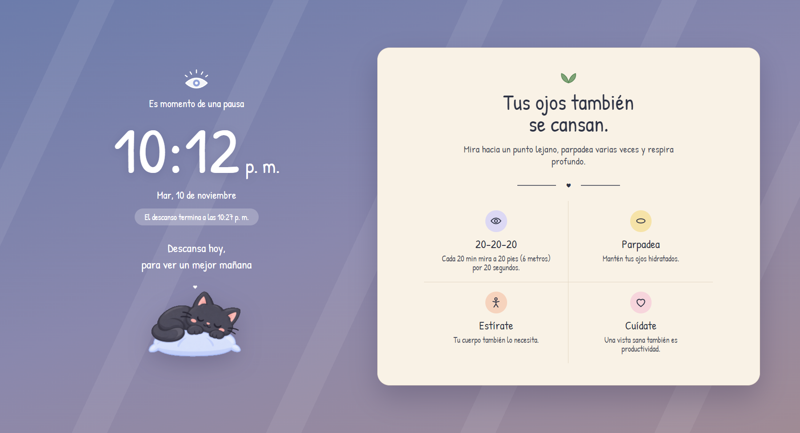
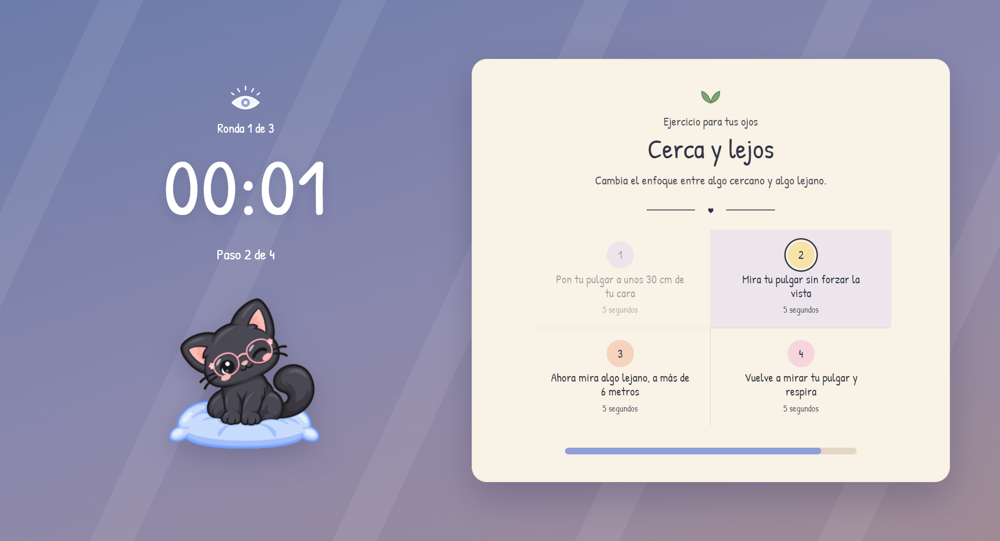

# EyBrek — Manual de usuario

EyBrek bloquea la pantalla de forma periódica para que tu vista descanse de
verdad. Durante la pausa te muestra un ejercicio visual guiado.

---

## 1. Instalación

### 1.1. Lo único que necesitas

El archivo **`EyBrek-Instalador-1.0.0.exe`** (en la carpeta `client\dist`).
No hace falta instalar Node.js, MySQL ni ningún servidor: las cuentas se
guardan en la nube (Supabase).

### 1.2. Puesta en marcha

1. Doble clic en **`EyBrek-Instalador-1.0.0.exe`**. Si Windows muestra
   «Windows protegió su PC», elige **Más información → Ejecutar de todas formas**.
2. EyBrek se instala solo, crea un acceso directo en el escritorio y en el
   menú Inicio, y se abre.
3. Desde entonces arranca solo con Windows y queda en la bandeja del sistema.
4. En la aplicación, presiona **Regístrate** y crea tu cuenta con nombre,
   correo y contraseña (mínimo 8 caracteres).
5. Inicia sesión. EyBrek aplica la **configuración por defecto**: bloqueo
   activado, cada 2 horas, 15 minutos de duración, horario de 8:00 a. m. a
   9:00 p. m. y notificaciones activadas.

> Si la confirmación por correo está activa en Supabase, revisa tu correo y
> confirma la cuenta antes de iniciar sesión.



### 1.3. Si quieres una base de datos MySQL en vez de SQLite

Opcional. Solo tiene sentido si quieres una base de datos **central**
compartida por varias personas. En ese caso:

1. En MySQL Workbench, abre y ejecuta `database/01_esquema_mysql.sql` y
   luego `database/02_datos_iniciales.sql`. Se crea la base `eybrek` con sus
   tablas y los 4 ejercicios.
2. Crea un usuario para la aplicación con permisos sobre esa base.
3. Copia `server/.env.example` como `server/.env` y completa `DB_MOTOR=mysql`,
   `DB_USER` y `DB_PASSWORD`.

El archivo `.env` está excluido de git: la contraseña **no se sube al
repositorio**.

---

## 2. Configuración



| Opción | Qué hace | Valores permitidos |
|---|---|---|
| **Activar bloqueo** | Activa o desactiva el bloqueo de pantalla. | Encendido / Apagado |
| **Bloquear cada** | Cada cuánto se activa el descanso. | 15 y 30 minutos, 1, 2, 4 u 8 horas |
| **Tiempo de bloqueo** | Cuánto dura la pausa. | 5, 10, 15, 20 o 30 minutos |
| **Horario** | Rango del día en que se activa el bloqueo. | Cualquier hora del día |
| **Notificaciones** | Avisa un minuto antes del descanso. | Encendido / Apagado |
| **Consejos en pantalla** | Muestra consejos de salud visual durante la pausa. | Encendido / Apagado |

**Reglas que valida la aplicación:**

- El intervalo debe estar entre **15 minutos y 8 horas**.
- La duración debe estar entre **1 y 30 minutos**.
- La duración debe ser **menor** que el intervalo.
- La hora de fin debe ser distinta de la hora de inicio.

Si escribes un valor no permitido, la aplicación te dice exactamente cuál es el
rango correcto y **no** guarda el cambio.

Cuando presionas **Guardar cambios** aparece un mensaje de confirmación. La
configuración queda guardada en el servidor y también en una copia local del
equipo.

**Ver la pantalla de descanso** abre la pausa inmediatamente, sin esperar a
que se cumpla el intervalo. Sirve para comprobar cómo se ve y para presentar
la aplicación.

---

## 3. La pausa

Cuando se cumple el intervalo, la pantalla se bloquea:



La pausa pasa por dos pantallas:

1. **Descanso** (gato dormido): durante los primeros **40 segundos** verás la
   hora actual (por ejemplo, *9:12 p. m.*), la fecha y la hora en que termina
   el descanso; a la derecha, cuatro consejos para tu vista (si tienes
   activados los *Consejos en pantalla*).
2. **Ejercicio para tus ojos** (gato con gafas): después aparece **un solo
   ejercicio**, dividido en **4 pasos**. Los pasos se ven en la cuadrícula y
   se resalta el que toca; el temporizador grande marca los segundos de ese
   paso. Los 4 pasos se repiten **2 o 3 rondas**, según el ejercicio, con
   5 segundos para descansar los ojos entre una ronda y otra. Al terminar
   vuelves a la pantalla de descanso hasta que se desbloquee.



La pausa **no se puede omitir**:

- El bloqueo cubre toda la pantalla, incluida la barra de tareas, y vuelve
  al frente en medio segundo si se abre el menú Inicio u otra ventana.
- Si EyBrek se cierra a la fuerza (por ejemplo, con *Finalizar tarea* en el
  Administrador de tareas), un pequeño proceso vigilante la vuelve a abrir en
  segundos y el bloqueo sigue con el tiempo que faltaba. Si se apaga el
  equipo, el descanso también se retoma al encenderlo, si aún no terminó.

Cuando termina el tiempo configurado, la pantalla se desbloquea sola y el
conteo del intervalo empieza de nuevo.

Un minuto antes de cada pausa recibes una notificación del sistema.

---

## 4. La rotación de ejercicios

El catálogo tiene **12 ejercicios** y en cada pausa se muestra uno distinto,
en orden: «Cerca y lejos», «Parpadeo», «En círculos», «Palmas», «Regla
20-20-20», «Ocho acostado», «Arriba y abajo», «De lado a lado», «Diagonales»,
«Parpadeo rápido», «Apretar y abrir» y «Sigue tu dedo». Solo cuando se han
mostrado los 12 vuelve a empezar con el primero, así que con la
configuración por defecto (un descanso cada 2 horas de 8 a. m. a 9 p. m.)
ningún ejercicio se repite en el mismo día. El avance se guarda por usuario
en el servidor, así que cada persona tiene su propia rotación.

---

## 5. Trabajar en equipo

### Un servidor para todos (recomendado si están en la misma red)

1. Una persona levanta el servidor en su equipo: `npm start` en `server/`.
2. Las demás copian la carpeta `client/` y ejecutan `npm start`.
3. Las demás se registran con su propio correo y contraseña.

Cada persona tiene su cuenta en el servidor del equipo, así que su
configuración la acompaña a cualquier equipo. Para saber a qué dirección
apunta el cliente, mire `client/src/config.json`:

```json
{
  "servidorUrl": "http://DESKTOP-CTLL6OH:3000/api",
  "servidorUrlAlternativo": "http://127.0.0.1:3000/api",
  "servidorUrlRespaldo": "http://192.168.0.12:3000/api"
}
```

Se usa el **nombre del equipo** y no la dirección IP, porque el nombre se
resuelve dentro de la red local y no cambia cuando el router le renueva la
IP. Si cambia, actualice la línea `servidorUrlRespaldo`.

### Si no están en la misma red

En el equipo del servidor, active **Configuración → Red e Internet → Punto de
acceso móvil** (Windows 10 y 11). Los demás se conectan a ese punto de acceso
y en `config.json` ponen la dirección `http://192.168.137.1:3000/api`.

### Si el servidor no está disponible

**La aplicación sigue funcionando igual.** Usa la copia local de tu
configuración y sigue bloqueando la pantalla. Los cambios que guardes durante
ese tiempo se suben solos al servidor en cuanto vuelva. No se muestra ningún
aviso: la aplicación simplemente funciona.

---

## 6. Cerrar sesión y salir

- **Cerrar sesión** (barra lateral o bandeja del sistema) cierra la sesión en
  el servidor y detiene el conteo. Vuelve a la pantalla de acceso.
- Si cierras la ventana con la **X** mientras tienes una sesión abierta, EyBrek
  sigue funcionando en segundo plano. Para volver a la ventana, haga doble
  clic en el icono de EyBrek en la bandeja del sistema.
- Para salir por completo: clic derecho en el icono de la bandeja → **Salir**.

---

## 7. Problemas frecuentes

**"No se pudo conectar con el servidor de EyBrek".**
Ocurre al iniciar sesión si no hay ningún servidor al alcance. Si su equipo
tiene el suyo, abra `npm start` en `server/`. Si comparte el de otra persona,
revise que la dirección de `config.json` sea la correcta y que ambos estén
en la misma red.

**La pantalla se bloquea a destiempo.**
El bloqueo ocurre con una desviación máxima de 2 segundos (RNF-03). Si el
equipo está muy cargado o hay muchos procesos, puede demorarse un poco más.

**Olvidé la contraseña.**
La recuperación de contraseña está fuera del alcance de esta versión. Cree
una cuenta nueva con otro correo.

**Quiero cambiar los ejercicios.**
Los ejercicios son datos, no código (RNF-07). En SQLite, abra el archivo
`server/datos/eybrek.db` con cualquier editor de SQLite; en MySQL, edite la
tabla `Ejercicio` en MySQL Workbench. Reinicie el servidor después.

**Quiero reiniciar la rotación de ejercicios.**
Cada bloqueo avanza un ejercicio. Para volver al primero, borre la fila de la
tabla `ProgresoRotacion` del usuario (en SQLite: `DELETE FROM ProgresoRotacion
WHERE id_usuario = <id>;`).

**Quiero saber qué está pasando.**
La bitácora de la aplicación está en `%APPDATA%\eybrek-client\eybrek.log`.
